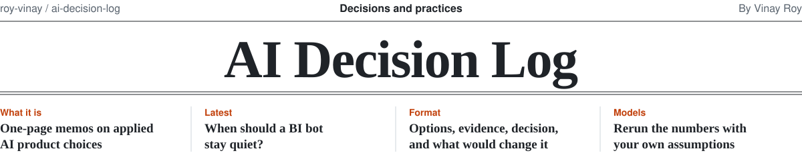
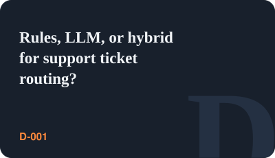
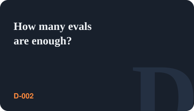
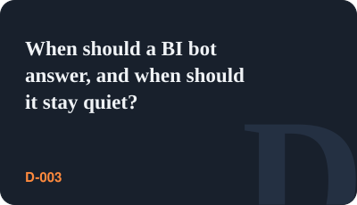

<picture>
  <source media="(prefers-color-scheme: dark)" srcset=".github/assets/masthead-dark.svg">
  
</picture>

&nbsp;

One-page memos on real product decisions in applied AI: what the options were, the numbers, what was
picked, and what would change the answer.

Most writing about AI products covers what to build. These memos cover **how to choose**, with the
trade-offs and the "revisit if" conditions left in. Where a memo has numbers, the model that produced
them is in [`models/`](models/) so you can change the assumptions and rerun it.

Numbers are illustrative and company-agnostic. The reasoning is the point.

## Decisions

<a href="decisions/D-001-ticket-routing-rules-llm-hybrid.md"><picture><source media="(prefers-color-scheme: dark)" srcset=".github/assets/tile-d-001-dark.svg"></picture></a>
<a href="decisions/D-002-how-many-evals-are-enough.md"><picture><source media="(prefers-color-scheme: dark)" srcset=".github/assets/tile-d-002-dark.svg"></picture></a>
<a href="decisions/D-003-when-should-a-bi-bot-stay-quiet.md"><picture><source media="(prefers-color-scheme: dark)" srcset=".github/assets/tile-d-003-dark.svg"></picture></a>

### Coming next

- **D-004.** Rules or an LLM classifier for prompt-injection screening?
- **D-005.** RAG or long context for a policy knowledge base?
- **D-006.** One model, or route between a small and a large one?
- **D-007.** Structured output or free text for customer-facing answers?
- **D-008.** When is fine-tuning worth it?
- **D-009.** Should an agent explain its decision to the user?

## Format

Every memo follows [`TEMPLATE.md`](TEMPLATE.md): Context, Options, Evidence, Decision, Why,
Trade-offs accepted, Revisit if. One page, no more.

## About

<a href="https://www.linkedin.com/in/royvinay"><picture><source media="(prefers-color-scheme: dark)" srcset="https://raw.githubusercontent.com/roy-vinay/roy-vinay/main/cards/about-dark.svg"></picture></a>

VP of Product at [Burq.ai](https://burq.ai), leading Product and AI.

Before Burq, I was the founding product leader at an AI SaaS startup, taking it from zero to product-market fit and building multi-agent systems in production. Before that, I led a global team of about 80 across Product, Data Science and Analytics at Vista, the private aviation group behind VistaJet and XO. Earlier: marketplace growth at Zeus Living, macOS and iOS features at Apple (including Sidecar), and engineering teams at Qualcomm and NVIDIA.

For seven years I was Head Instructor for the AI/ML executive program at UC Berkeley Executive Education, teaching more than 10,000 business leaders. 3 US patents, MBA from Berkeley Haas, MS from IIT Roorkee. San Jose, CA.

<picture>
  <source media="(prefers-color-scheme: dark)" srcset="https://raw.githubusercontent.com/roy-vinay/roy-vinay/main/dark_mode.svg">
  
</picture>

## License

Memos: CC BY 4.0. Code: MIT.

---

<strong>Independently developed.</strong> Not affiliated with or endorsed by my employer. 
<strong>Confidentiality:</strong> No proprietary code, data, or confidential information is included.
