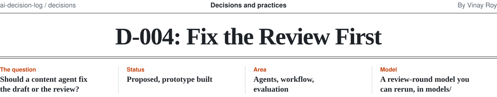

<picture>
  <source media="(prefers-color-scheme: dark)" srcset="../.github/assets/d-004-masthead-dark.svg">
  
</picture>

The numbers come from [`models/d004_review_rounds.py`](../models/d004_review_rounds.py), so you can change the assumptions and rerun it.
The prototype this memo argues for is [Brand Review](https://github.com/roy-vinay/applied-ai-agents/tree/main/agents/brand-review) ([live demo](https://brand-review-demo.vercel.app)).

## Context

In regulated marketing (banks, credit unions, insurers), an AI tool can draft a campaign in minutes. Getting
it approved still takes rounds of Legal, Brand and Compliance review. Each round is a queue: the reviewer
gets to it when they can, sends notes, the marketer fixes, it goes back.

Reviewers raise three kinds of objection:

1. **Written rules.** A missing disclaimer, low contrast, a logo too small. Documented, checkable in code.
2. **Repeat, unwritten rules.** "Legal always strikes 'guaranteed' on loans." Nobody wrote it down, but the
   same reviewer makes the same fix every time.
3. **Novel judgment calls.** Genuinely new questions no tool could have predicted.

Most AI content tools invest in better drafts. The question is whether that is where the time goes.

## Options

| | Option | How it works |
| --- | --- | --- |
| A | Better generation | Higher-quality drafts; review works as it does today |
| B | + Written-rule checks | A, plus deterministic brand checks that fix rule breaks before review |
| C | + Reviewer-taught lessons | B, plus each reviewer's past corrections stored as scoped lessons and applied to new drafts; the agent nudges on due dates |
| D | + Focused review | C, plus reviewers get one highlighted decision with context instead of a whole file |

## Evidence

From the model in this repo: 20,000 simulated campaigns, about 2 objections each before pre-review
(30% written, 45% repeat, 25% novel). A reviewer skimming a whole file spots 75% of what's there per round;
with one focused decision, 92%. Lessons catch the right repeat objection 70% of the time.
All of these are assumptions, stated in the script.

| Option | Rounds | Cut vs A | First-pass approval | 3+ rounds | p90 days | Issues missed by review |
| --- | ---: | ---: | ---: | ---: | ---: | ---: |
| A Better generation | 2.24 | | 19% | 35% | 5.1 | 18.8% |
| B + Written-rule checks | 1.98 | 11% | 31% | 24% | 5.1 | 17.5% |
| C + Reviewer-taught lessons | 1.61 | 28% | 52% | 11% | 3.6 | 14.2% |
| D + Focused review | 1.66 | 26% | 45% | 10% | 2.3 | **4.1%** |

Three things stand out:

- **Unwritten rules are the biggest lever.** Rule checks alone cut rounds 11%. Adding lessons more than doubles that.
- **Focused review looks worse on rounds and is far better.** Reviewers catch more, so a few campaigns take an
  extra round, but missed issues fall from 14% to 4% and p90 time drops to 2.3 days. Optimize rounds alone and
  you would reward reviewers for missing things.
- **Halving rounds is near the ceiling.** Every campaign needs at least one round, so the most any option can cut
  here is 55%. With 90% lesson recall, D cuts 31%. The best case tried (10% novel, 90% recall) reaches 40%.
  With most objections novel (60%), D cuts only 13%.

## Decision

**D.** Build the review loop, not a better generator: rule checks, reviewer-taught lessons, nudges, and a
focused one-decision review. Measure it with **rounds and missed issues together**, and set the target at
**30% fewer rounds**, with 50% as a stretch.

## Why

1. **Repeat, unwritten objections are where the rounds are.** They are also what only a customer's own
   reviewers can teach, which makes the result hard to copy.
2. **The worst outcome is a miss, not a round.** In regulated marketing, a claim that slips past review costs
   far more than a day's delay. D is the only option that cuts misses by more than a quarter.
3. **Better generation doesn't touch the queue.** Option A's drafts still wait 1.5 days per round.

## Trade-offs accepted

- **Lessons can go stale or conflict.** Each one needs an owner, a scope and a retirement date; conflicts go
  back to the marketer, not to the model.
- **Reviewers must tag a reason with each correction** so it can become a lesson. That is a small new habit.
- **Generation quality stays "good enough"** rather than best in class, on purpose.

## Revisit if

- **Novel objections are more than half** of what reviewers raise. Then lessons help little; invest in
  reviewer tooling and faster queues instead.
- **Lesson recall stays below 50%** after a month of use. Retrieval isn't finding the right lesson; fix that
  before scaling.
- **Missed issues rise** while rounds fall. The system is training reviewers to skim. Stop and rework review.

## What I'd tell a team starting this

Before building anything, tag a month of review comments as written, repeat or novel. That one count tells
you whether to build lessons at all, and how big a cut to promise.
